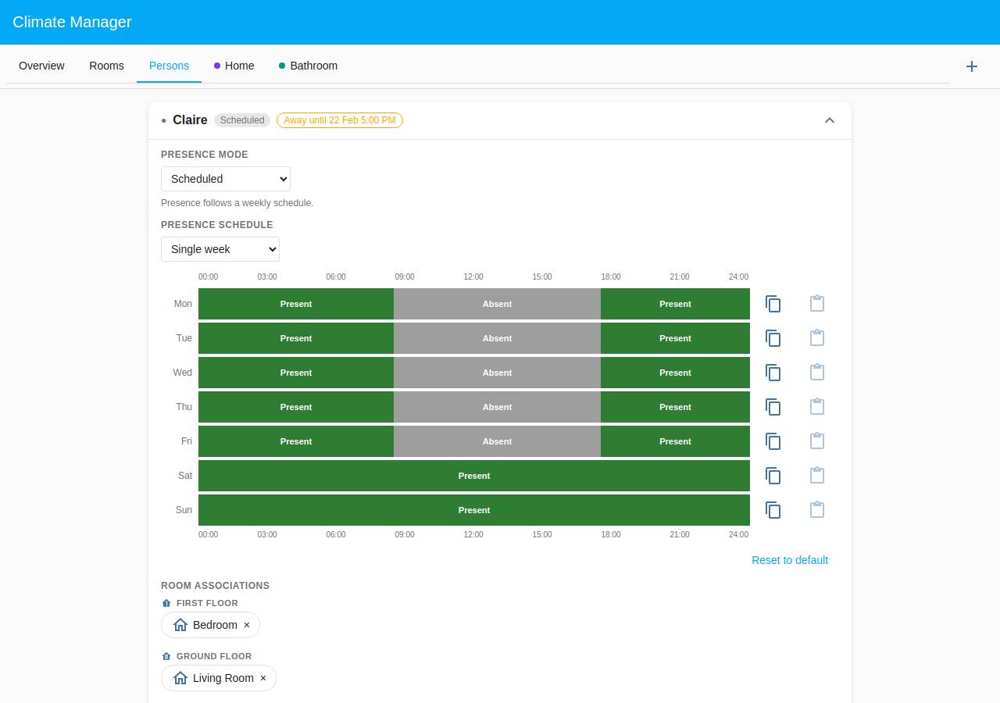
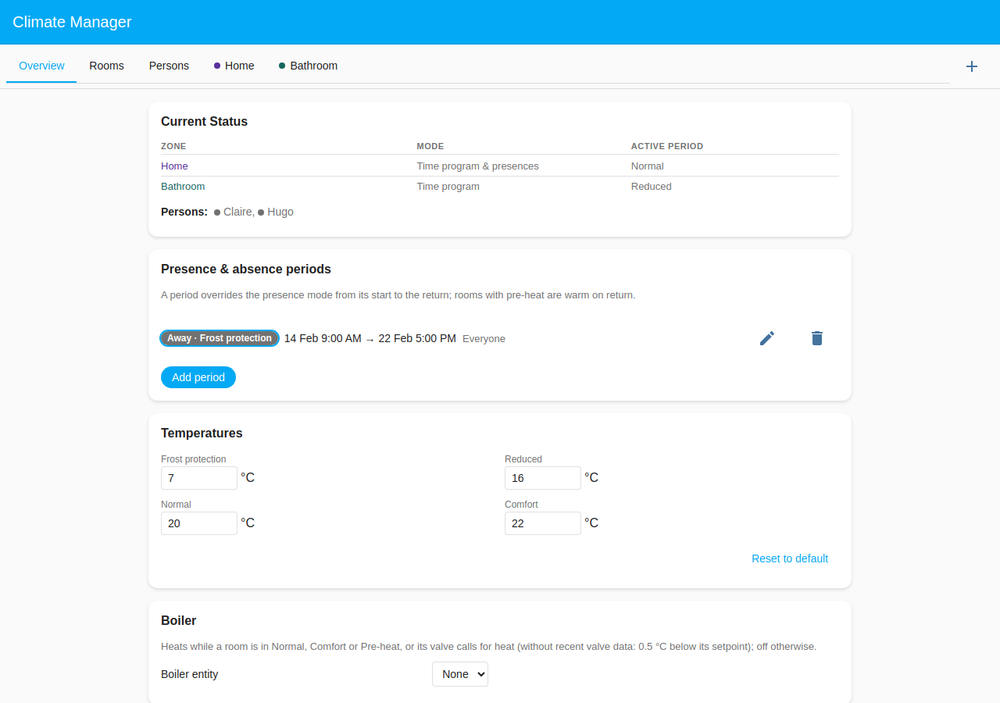
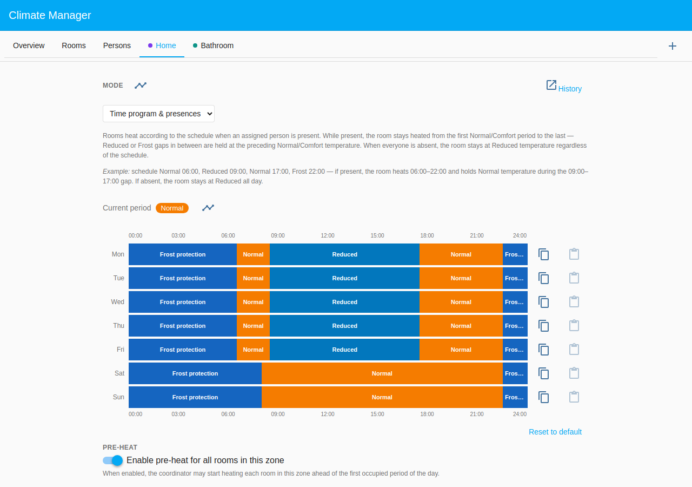
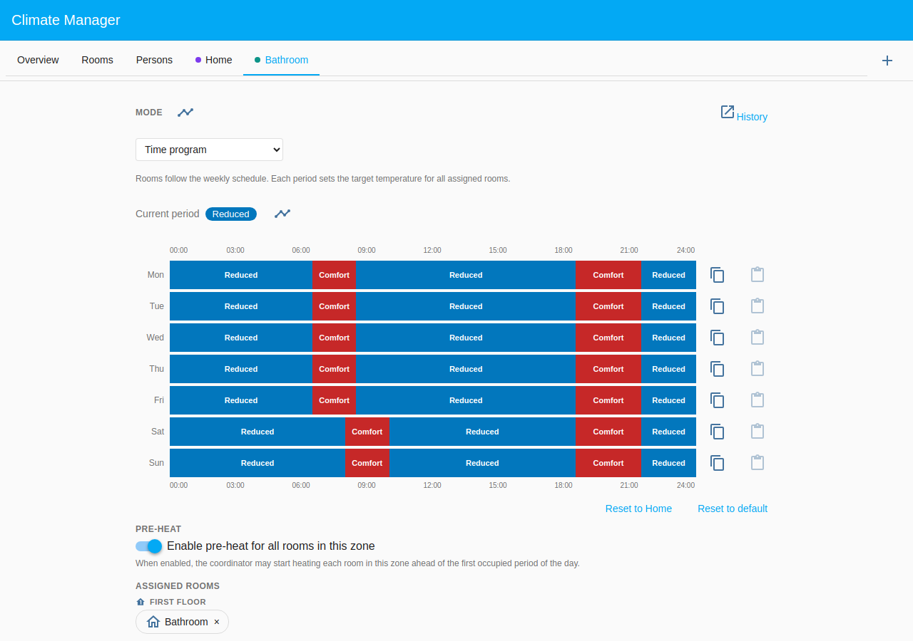
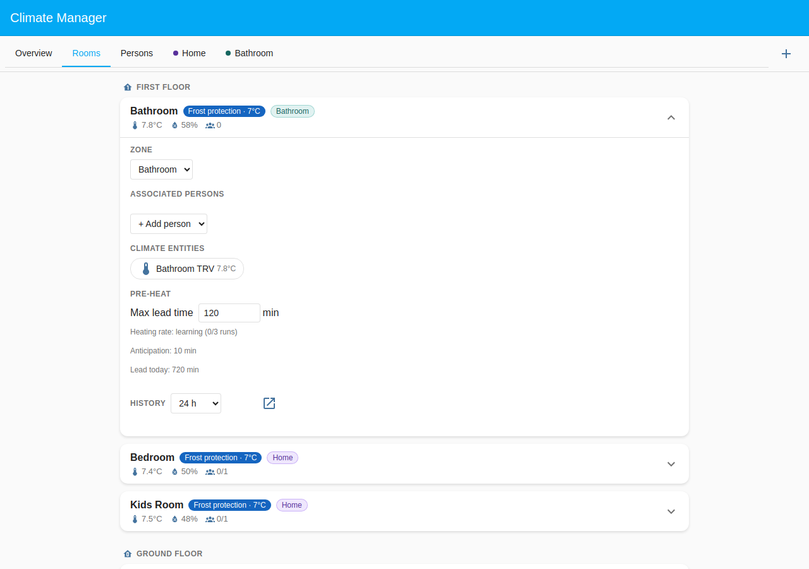
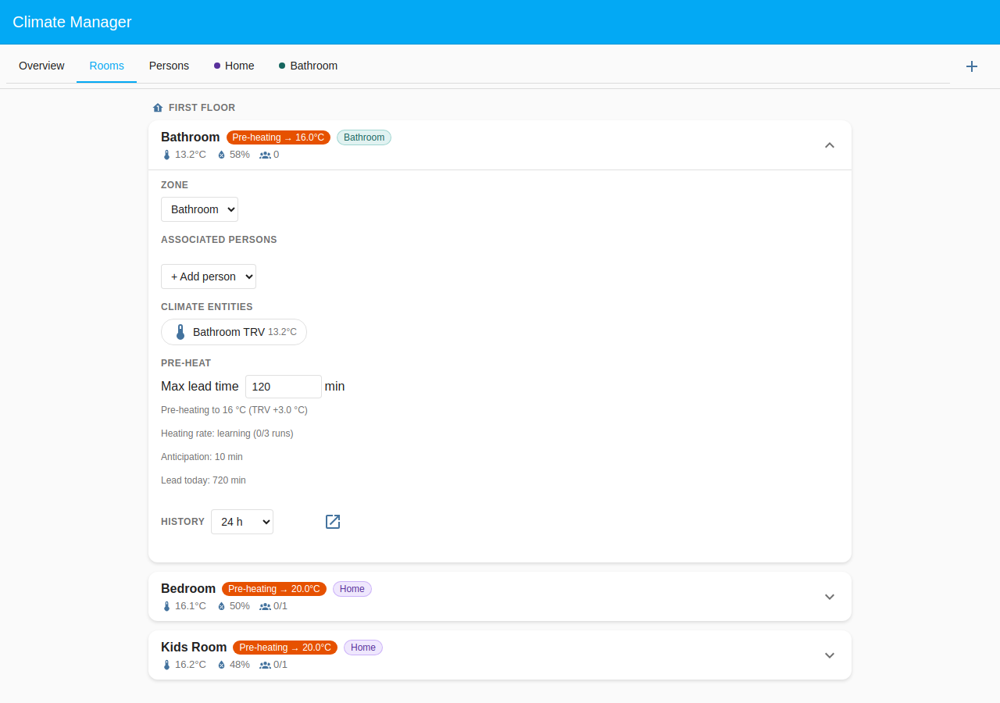

# Claire & Hugo: Family Holiday

Claire and Hugo both work office hours, and their weekly **Scheduled** presence
says so: home until 08:30, away until 17:30, home all weekend. But in February
the whole family goes skiing for a week. Rather than editing two schedules (and
forgetting to put them back), they add one **Presence & absence period** on the
Overview tab: an **Absence** for **Everyone**, from Saturday 14 February 09:00
to the **Return** on Sunday 22 February 17:00, with the **Setback** at **Frost
protection**.

This scenario showcases the period overriding the weekly schedules, a household
absence holding every room at Frost protection (a _Time program_ zone too), and
pre-heat starting well ahead of the return so the house is warm when the family
walks in.

## Table of Contents

- [Configuration](#configuration)
  - [Household layout](#household-layout)
  - [Presence configuration](#presence-configuration)
  - [The holiday period](#the-holiday-period)
  - [Zone schedules](#zone-schedules)
- [What happens](#what-happens)

## Configuration

### Household layout

| Room        | Zone        | Floor        | Heats when                                 |
| ----------- | ----------- | ------------ | ------------------------------------------ |
| Living Room | Home (Def.) | Ground Floor | Home programme, Claire or Hugo present     |
| Bedroom     | Home (Def.) | First Floor  | Home programme, Claire present             |
| Kids Room   | Home (Def.) | First Floor  | Home programme, Hugo present               |
| Bathroom    | Bathroom    | First Floor  | Bathroom programme, unless everyone's away |

The **Home** zone is _Time program & presences_, so each of its rooms needs a
person in its **Room associations**: Claire has the Living Room and Bedroom,
Hugo the Living Room and Kids Room. The **Bathroom** zone is _Time program_: it
heats on schedule with nobody assigned. Both zones have **Pre-heat** enabled,
and every room has a **Max lead time** of 120 minutes.

### Presence configuration

Both persons use **Scheduled** presence with a **Single week** schedule: Present
until 08:30, Absent 08:30–17:30 on weekdays, Present all weekend. Someone asleep
at home is present, so the nights are Present too.

<picture>
  <source media="(prefers-color-scheme: dark)"
          srcset="screenshots/dark/persons.png">
  
</picture>

The expanded Claire card still shows her weekly schedule, untouched. The **Away
until 22 Feb 5:00 PM** badge next to her name says the holiday period overrides
it until the return.

### The holiday period

<picture>
  <source media="(prefers-color-scheme: dark)"
          srcset="screenshots/dark/overview-present.png">
  
</picture>

The **Presence & absence periods** card lists the holiday: **Away · Frost
protection**, 14 Feb 9:00 AM → 22 Feb 5:00 PM, **Everyone**.

- For these dates the period wins over both Scheduled presences, whatever the
  weekly schedule says.
- No person is selected, so it is a household absence. Its **Setback** holds
  every room at Frost protection while the house is empty, the _Time program_
  Bathroom zone too, though that zone has no assigned person.
- The editor proposed Frost protection because the absence lasts more than 2
  days; a shorter one gets Reduced, and either can be chosen.
- Pre-heat aims at the **Return**. Coming back from a household absence is a
  bigger rise, so a room may start up to 12 hours ahead, beyond its **Max lead
  time**.
- After the return the weekly schedules take over again, and the ended period
  disappears from the card on its own.

### Zone schedules

The weekly time program sets each zone's heating window; presence only gates
whether that schedule is followed. A zone never heats before its first scheduled
Normal/Comfort period or after the last, present or not.

<picture>
  <source media="(prefers-color-scheme: dark)"
          srcset="screenshots/dark/schedule-home.png">
  
</picture>

The **Home** zone is Normal 06:30–08:30 and 17:30–22:30 on weekdays, with
Reduced in between, and Normal 08:00–22:30 at weekends; Frost protection fills
the nights.

<picture>
  <source media="(prefers-color-scheme: dark)"
          srcset="screenshots/dark/schedule-bathroom.png">
  
</picture>

The **Bathroom** zone is Comfort for the morning wash (06:30–08:30 on weekdays,
08:00–10:00 at weekends) and every evening 18:30–21:30, and Reduced otherwise.

## What happens

### Mid-holiday (Wednesday 18 February, 19:00)

On a normal Wednesday at 19:00 both parents would be home: the Home rooms would
be at Normal and the Bathroom at Comfort. The family is away, so the period
holds every room at Frost protection.

<picture>
  <source media="(prefers-color-scheme: dark)"
          srcset="screenshots/dark/overview-away.png">
  
</picture>

Claire and Hugo are absent (grey dots). The zone rows show each programme's
current period, Normal for Home and Comfort for Bathroom; what the rooms apply
is on the Rooms tab.

<picture>
  <source media="(prefers-color-scheme: dark)"
          srcset="screenshots/dark/rooms-away.png">
  
</picture>

Every room shows **Frost protection · 7°C**, the Bathroom included: its
programme is in its evening Comfort slot, but the household absence holds the
_Time program_ zone at its setback too.

### Before the return (Sunday 22 February, 15:30)

The family is due back at 17:00, and the Home programme is at Normal all Sunday
afternoon. Coming back from Frost protection, pre-heat started the rooms up to
12 hours ahead of the return, while the period still counts everyone as away.

<picture>
  <source media="(prefers-color-scheme: dark)"
          srcset="screenshots/dark/rooms-present.png">
  
</picture>

Bedroom, Kids Room and Living Room show **Pre-heating → 20.0°C** with nobody
present yet: the house will be at Normal when the family walks in. The Bathroom
shows **Pre-heating → 16.0°C**: its programme is Reduced until 18:30, so it
warms back to Reduced for the return, then pre-heats on schedule for its evening
Comfort slot.
